<!-- Visuals are animated SVGs built by scripts/build.py. The open source wall, skyline and PR list are refreshed by scripts/refresh.py through GitHub Actions. -->

<a href="https://www.yashvardhan.tech"><picture><source media="(prefers-color-scheme: dark)" srcset="assets/hero-dark.svg"></picture></a>

  <a href="https://calendly.com/yashvt9404/30min"><picture><source media="(prefers-color-scheme: dark)" srcset="assets/l-call-dark.svg"></picture></a>
  <a href="https://www.yashvardhan.tech"><picture><source media="(prefers-color-scheme: dark)" srcset="assets/l-portfolio-dark.svg"></picture></a>
  <a href="https://www.llmslim.app"><picture><source media="(prefers-color-scheme: dark)" srcset="assets/l-llmslim-dark.svg"></picture></a>
  <a href="https://www.linkedin.com/in/yashvardhanthanvi"><picture><source media="(prefers-color-scheme: dark)" srcset="assets/l-linkedin-dark.svg"></picture></a>
  <a href="mailto:yashvt9404@gmail.com"><picture><source media="(prefers-color-scheme: dark)" srcset="assets/l-email-dark.svg"></picture></a>
  <a href="https://www.yashvardhan.tech/Yashvardhan-Thanvi-Resume.pdf"><picture><source media="(prefers-color-scheme: dark)" srcset="assets/l-resume-dark.svg"></picture></a>

I'm a final-year BCA student at BIT Mesra, Jaipur, and the founder of <a href="https://www.llmslim.app"><b>LLMSlim</b></a>, open source context infrastructure for AI agents, built under my studio <a href="https://ameyor.in"><b>AMEYOR</b></a>. Most recently I was an AI/ML research intern at DRDO's Scientific Analysis Group. I also take on <b>freelance work</b>: Python backends, retrieval systems, AI features, and getting a prototype into someone's hands.

 

<picture><source media="(prefers-color-scheme: dark)" srcset="assets/h-building-dark.svg"></picture>

<a href="https://www.llmslim.app"><picture><source media="(prefers-color-scheme: dark)" srcset="assets/llmslim-dark.svg"></picture></a>

  <a href="https://www.llmslim.app">Website</a> &nbsp;·&nbsp; <a href="https://www.llmslim.app/docs/getting-started">Docs</a> &nbsp;·&nbsp; <a href="https://www.llmslim.app/benchmarks">Benchmarks</a> &nbsp;·&nbsp; <a href="https://pypi.org/project/llmslim/">PyPI</a> &nbsp;·&nbsp; <a href="https://github.com/Thanatos9404/llmslim">Source</a> &nbsp;·&nbsp; <a href="https://www.producthunt.com/products/llmslim">Product Hunt</a>

 

<picture><source media="(prefers-color-scheme: dark)" srcset="assets/h-work-dark.svg"></picture>

  <a href="https://github.com/Thanatos9404/Krishyak"><picture><source media="(prefers-color-scheme: dark)" srcset="assets/p-krishyak-dark.svg"></picture></a>
  <a href="https://github.com/Thanatos9404/polygraph"><picture><source media="(prefers-color-scheme: dark)" srcset="assets/p-polygraph-dark.svg"></picture></a>
   Krishyak <a href="https://krishyak.vercel.app">live app</a> &nbsp;·&nbsp; Polygraph <a href="https://yvt94-polygraph.static.hf.space">live demo</a> and <a href="https://youtu.be/VFzUl18uwP8">video</a>

  <a href="https://github.com/Thanatos9404/pratibimb"><picture><source media="(prefers-color-scheme: dark)" srcset="assets/p-pratibimb-dark.svg"></picture></a>
  <a href="https://github.com/Thanatos9404/canopyproof"><picture><source media="(prefers-color-scheme: dark)" srcset="assets/p-canopyproof-dark.svg"></picture></a>
   Pratibimb <a href="https://pratibimb-omega.vercel.app">live console</a> &nbsp;·&nbsp; CanopyProof <a href="https://youtu.be/9FBv9KQ4Ag8">video</a>

  <a href="https://github.com/Thanatos9404/passerelle"><picture><source media="(prefers-color-scheme: dark)" srcset="assets/p-passerelle-dark.svg"></picture></a>
  <a href="https://github.com/Thanatos9404/hearthbeat"><picture><source media="(prefers-color-scheme: dark)" srcset="assets/p-hearthbeat-dark.svg"></picture></a>
   Passerelle <a href="https://youtu.be/bjc88UYdgfE">video</a> &nbsp;·&nbsp; Hearthbeat <a href="https://youtu.be/axVTrTiKaog">video</a>

Also <a href="https://github.com/Thanatos9404/leash">Leash</a>, spending mandates for AI shopping agents &nbsp;·&nbsp; <a href="https://github.com/Thanatos9404/StudyTwin">StudyTwin</a>, a tutor that cites your course material &nbsp;·&nbsp; <a href="https://ruledost.vercel.app">RuleDost</a>, hackathon rules decoded &nbsp;·&nbsp; <a href="https://github.com/Thanatos9404/dayrhythm">dayrhythm</a>, a routine-learning library &nbsp;·&nbsp; <a href="https://github.com/Thanatos9404/Intuix-NASA">Intuix</a>, exoplanet detection for NASA Space Apps

 

<picture><source media="(prefers-color-scheme: dark)" srcset="assets/h-oss-dark.svg"></picture>

<picture><source media="(prefers-color-scheme: dark)" srcset="assets/oss-dark.svg"></picture>

<!-- OSS:START -->

<b>All 47 pull requests</b>, by organisation

**ModelScope**

- `merged` [fix(needle_haystack): keep context length and depth as metric dimensions](https://github.com/modelscope/evalscope/pull/1851) modelscope/evalscope#1851
- `merged` [fix(metrics): name numeric dimensions in metric labels](https://github.com/modelscope/evalscope/pull/1856) modelscope/evalscope#1856

**AWS**

- `merged` [refactor(296): remove the dead ConfusionMatrixCalculator methods](https://github.com/awslabs/stickler/pull/390) awslabs/stickler#390
- `open` [refactor(395): remove the remaining dead confusion-matrix paths](https://github.com/awslabs/stickler/pull/398) awslabs/stickler#398
- `open` [fix(core): reject checkpoints at virtual child ids](https://github.com/aws/aws-durable-execution-sdk-python/pull/778) aws/aws-durable-execution-sdk-python#778
- `open` [fix(E3620): Add db.serverless to the DocumentDB instance classes](https://github.com/aws-cloudformation/cfn-lint/pull/4761) aws-cloudformation/cfn-lint#4761
- `open` [fix(E3670): Use full xlarge names for Amazon MQ instance types](https://github.com/aws-cloudformation/cfn-lint/pull/4760) aws-cloudformation/cfn-lint#4760
- `open` [fix(292): format the budget key as a number in Bulk_Confidence_AUROC](https://github.com/awslabs/stickler/pull/396) awslabs/stickler#396
- `open` [fix(testing): fail fast on invalid handler output](https://github.com/aws/aws-durable-execution-sdk-python/pull/777) aws/aws-durable-execution-sdk-python#777
- `open` [fix: Skip E1029 where CloudFormation doesn't evaluate Fn::Sub](https://github.com/aws-cloudformation/cfn-lint/pull/4759) aws-cloudformation/cfn-lint#4759

**NVIDIA**

- `merged` [fix: break models.errors import cycle](https://github.com/NVIDIA-NeMo/DataDesigner/pull/1039) NVIDIA-NeMo/DataDesigner#1039
- `open` [fix(checkpoint): stop training at the next step after a failed background save](https://github.com/NVIDIA-NeMo/RL/pull/4729) NVIDIA-NeMo/RL#4729
- `open` [fix(llm): retry structured calls that return no result](https://github.com/NVIDIA/SkillSpector/pull/845) NVIDIA/SkillSpector#845
- `open` [fix(instruction_following): split counting_composition on `* * *` and stop counting punctuation as words](https://github.com/NVIDIA-NeMo/Gym/pull/4624) NVIDIA-NeMo/Gym#4624

**IBM**

- `merged` [feat: add an opt-in raise mode for LLM errors in the pipeline stages](https://github.com/IBM/FactReasoner/pull/63) IBM/FactReasoner#63
- `open` [fix(oauth): refresh DB-stored OAuth tokens once under concurrent requests](https://github.com/IBM/mcp-context-forge/pull/7222) IBM/mcp-context-forge#7222

**Pydantic**

- `merged` [Treat `logfire.tags` passed through logging and loguru as log tags](https://github.com/pydantic/logfire/pull/2550) pydantic/logfire#2550

**Meta**

- `open` [refactor: compute component plot data in private helpers](https://github.com/facebook/prophet/pull/2756) facebook/prophet#2756
- `open` [Fix sample_around_best with HigherOrderGP](https://github.com/meta-pytorch/botorch/pull/3424) meta-pytorch/botorch#3424
- `open` [Fix ClientIndex result merging for inner product and expose its metric_type](https://github.com/facebookresearch/faiss/pull/5732) facebookresearch/faiss#5732
- `open` [fix: do not modify the holidays dataframe passed to Prophet](https://github.com/facebook/prophet/pull/2757) facebook/prophet#2757
- `open` [(lexical-table) Bug Fix: Leave clicks on another editor's table to that editor](https://github.com/facebook/lexical/pull/9356) facebook/lexical#9356
- `open` [Preserve whitespace before `:` in except handlers without `as`](https://github.com/Instagram/LibCST/pull/1473) Instagram/LibCST#1473

**Capital One**

- `open` [fix: preserve nested report template paths](https://github.com/capitalone/datacompy/pull/590) capitalone/datacompy#590
- `open` [fix: align report tables using Unicode character widths](https://github.com/capitalone/datacompy/pull/589) capitalone/datacompy#589
- `open` [fix: declare UTF-8 consistently in saved HTML reports](https://github.com/capitalone/datacompy/pull/588) capitalone/datacompy#588

**Microsoft**

- `open` [fix(sleep): enforce max_tokens_per_night in the nightly cycle](https://github.com/microsoft/SkillOpt/pull/317) microsoft/SkillOpt#317
- `open` [fix(deployment): make rmtconfig file updates exclusive and atomic](https://github.com/microsoft/physical-ai-toolchain/pull/1944) microsoft/physical-ai-toolchain#1944
- `open` [Time out idle connections to the auth code receiver](https://github.com/AzureAD/microsoft-authentication-library-for-python/pull/971) AzureAD/microsoft-authentication-library-for-python#971

**Mozilla.ai**

- `open` [feat: add provider lifecycle cleanup and async context managers](https://github.com/mozilla-ai/any-llm/pull/1477) mozilla-ai/any-llm#1477
- `open` [fix(gemini): preserve provider tool-call IDs through replay](https://github.com/mozilla-ai/any-llm/pull/1476) mozilla-ai/any-llm#1476
- `open` [test: scope nested-loop teardown checks to bridge threads](https://github.com/mozilla-ai/any-llm/pull/1481) mozilla-ai/any-llm#1481

**Docling**

- `open` [fix(jats): keep the target of an ext-link in a mixed citation](https://github.com/docling-project/docling/pull/4813) docling-project/docling#4813
- `open` [fix(html): put formatting and hyperlinks inside the `
` and `<hN>` tags](https://github.com/docling-project/docling-core/pull/879) docling-project/docling-core#879

**NLTK**

- `open` [Take the default answer at the downloader's retry prompt when stdin is closed](https://github.com/nltk/nltk/pull/3965) nltk/nltk#3965
- `open` [Send set_proxy's credentials on the HTTPS CONNECT, and keep proxy credentials off redirects](https://github.com/nltk/nltk/pull/3970) nltk/nltk#3970

**OpenTelemetry**

- `open` [fix(dspy): record agent finish reasons for ReAct and ReActV2](https://github.com/open-telemetry/opentelemetry-python-genai/pull/885) open-telemetry/opentelemetry-python-genai#885
- `open` [fix(langchain): record dict-form assistant messages on workflow and agent spans](https://github.com/open-telemetry/opentelemetry-python-genai/pull/881) open-telemetry/opentelemetry-python-genai#881

**Scikit-HEP**

- `open` [fix(nanoevents): read RNTuple field descriptions as docstrings in dask mode](https://github.com/scikit-hep/coffea/pull/1646) scikit-hep/coffea#1646
- `closed` [feat: support to_2D/3D/4D, to_p* conversions and like() in Numba](https://github.com/scikit-hep/vector/pull/751) scikit-hep/vector#751

**Apache**

- `open` [Stop re-hashing node source on every execution (OpenTelemetry, caching)](https://github.com/apache/hamilton/pull/1756) apache/hamilton#1756

**Astropy**

- `closed` [Fix modeling separability of pseudocylindrical, Bonne and HEALPix projections](https://github.com/astropy/astropy/pull/20590) astropy/astropy#20590

**crewAI**

- `open` [fix(tools): serialize function tool callables as dotted paths](https://github.com/crewAIInc/crewAI/pull/8104) crewAIInc/crewAI#8104

**deepset**

- `open` [Add LLMSlim integration (document compressor)](https://github.com/deepset-ai/haystack-integrations/pull/655) deepset-ai/haystack-integrations#655

**Google**

- `closed` [Use checked arithmetic for GATHER shape products](https://github.com/google-ai-edge/LiteRT/pull/10846) google-ai-edge/LiteRT#10846

**libpng**

- `open` [fix: Correct interlaced 16-to-8-bit reads in the simplified API](https://github.com/pnggroup/libpng/pull/947) pnggroup/libpng#947

**Pillow**

- `open` [Check size arithmetic where it is used in the quantizers](https://github.com/python-pillow/Pillow/pull/10202) python-pillow/Pillow#10202

<!-- OSS:END -->

 

<picture><source media="(prefers-color-scheme: dark)" srcset="assets/h-proud-dark.svg"></picture>

<picture><source media="(prefers-color-scheme: dark)" srcset="assets/recognition-dark.svg"></picture>

 

<picture><source media="(prefers-color-scheme: dark)" srcset="assets/h-path-dark.svg"></picture>

<picture><source media="(prefers-color-scheme: dark)" srcset="assets/experience-dark.svg"></picture>

 

<picture><source media="(prefers-color-scheme: dark)" srcset="assets/h-activity-dark.svg"></picture>

<picture><source media="(prefers-color-scheme: dark)" srcset="assets/skyline-dark.svg"></picture>

 

<picture><source media="(prefers-color-scheme: dark)" srcset="assets/h-tools-dark.svg"></picture>

<picture><source media="(prefers-color-scheme: dark)" srcset="assets/toolbox-dark.svg"></picture>

 

<a href="https://calendly.com/yashvt9404/30min"><picture><source media="(prefers-color-scheme: dark)" srcset="assets/contact-dark.svg"></picture></a>

  <a href="mailto:yashvt9404@gmail.com">yashvt9404@gmail.com</a> &nbsp;·&nbsp; <a href="https://www.yashvardhan.tech">yashvardhan.tech</a> &nbsp;·&nbsp; <a href="https://ameyor.in">ameyor.in</a> &nbsp;·&nbsp; <a href="https://www.linkedin.com/in/yashvardhanthanvi">LinkedIn</a> &nbsp;·&nbsp; <a href="https://www.instagram.com/yashvardhan.thanvi/">Instagram</a>
    
  Every visual here is a hand-built, animated SVG. The open source wall, skyline and PR list refresh themselves twice a day.

