<!-- Generated by scripts/readme.py from scripts/content.py. Visuals come from scripts/build.py; the open source wall, skyline and PR list are refreshed by scripts/refresh.py through GitHub Actions. -->

<a href="https://www.yashvardhan.tech"><picture><source media="(prefers-color-scheme: dark)" srcset="assets/hero-dark.svg"></picture></a>

  <a href="https://calendly.com/yashvt9404/30min"><picture><source media="(prefers-color-scheme: dark)" srcset="assets/l-call-dark.svg"></picture></a>
  <a href="https://www.yashvardhan.tech"><picture><source media="(prefers-color-scheme: dark)" srcset="assets/l-portfolio-dark.svg"></picture></a>
  <a href="https://www.llmslim.app"><picture><source media="(prefers-color-scheme: dark)" srcset="assets/l-llmslim-dark.svg"></picture></a>
  <a href="https://www.linkedin.com/in/yashvardhanthanvi"><picture><source media="(prefers-color-scheme: dark)" srcset="assets/l-linkedin-dark.svg"></picture></a>
  <a href="mailto:yashvt9404@gmail.com"><picture><source media="(prefers-color-scheme: dark)" srcset="assets/l-email-dark.svg"></picture></a>
  <a href="https://www.yashvardhan.tech/Yashvardhan-Thanvi-Resume.pdf"><picture><source media="(prefers-color-scheme: dark)" srcset="assets/l-resume-dark.svg"></picture></a>

I'm a final-year BCA student at BIT Mesra, Jaipur, and the founder of <a href="https://www.llmslim.app"><b>LLMSlim</b></a>, open source context infrastructure for AI agents, built under my studio <a href="https://ameyor.in"><b>AMEYOR</b></a>. Most recently I was an AI/ML research intern at DRDO's Scientific Analysis Group. I also take on <b>freelance work</b>: Python backends, retrieval systems, AI features, and getting a prototype into someone's hands.

 

<picture><source media="(prefers-color-scheme: dark)" srcset="assets/h-building-dark.svg"></picture>

<a href="https://www.llmslim.app"><picture><source media="(prefers-color-scheme: dark)" srcset="assets/llmslim-dark.svg"></picture></a>

  <a href="https://www.llmslim.app">Website</a> &nbsp;·&nbsp; <a href="https://www.llmslim.app/docs/getting-started">Docs</a> &nbsp;·&nbsp; <a href="https://www.llmslim.app/benchmarks">Benchmarks</a> &nbsp;·&nbsp; <a href="https://pypi.org/project/llmslim/">PyPI</a> &nbsp;·&nbsp; <a href="https://github.com/Thanatos9404/llmslim">Source</a> &nbsp;·&nbsp; <a href="https://www.producthunt.com/products/llmslim">Product Hunt</a>

 

<picture><source media="(prefers-color-scheme: dark)" srcset="assets/h-work-dark.svg"></picture>

  <a href="https://github.com/Thanatos9404/Krishyak"><picture><source media="(prefers-color-scheme: dark)" srcset="assets/p-krishyak-dark.svg"></picture></a>
  <a href="https://github.com/Thanatos9404/polygraph"><picture><source media="(prefers-color-scheme: dark)" srcset="assets/p-polygraph-dark.svg"></picture></a>
   Krishyak <a href="https://krishyak.vercel.app">live app</a> &nbsp;·&nbsp; Polygraph <a href="https://yvt94-polygraph.static.hf.space">live demo</a> and <a href="https://youtu.be/VFzUl18uwP8">video</a>

  <a href="https://github.com/Thanatos9404/pratibimb"><picture><source media="(prefers-color-scheme: dark)" srcset="assets/p-pratibimb-dark.svg"></picture></a>
  <a href="https://github.com/Thanatos9404/canopyproof"><picture><source media="(prefers-color-scheme: dark)" srcset="assets/p-canopyproof-dark.svg"></picture></a>
   Pratibimb <a href="https://pratibimb-omega.vercel.app">live console</a> &nbsp;·&nbsp; CanopyProof <a href="https://youtu.be/9FBv9KQ4Ag8">video</a>

  <a href="https://github.com/Thanatos9404/passerelle"><picture><source media="(prefers-color-scheme: dark)" srcset="assets/p-passerelle-dark.svg"></picture></a>
  <a href="https://github.com/Thanatos9404/hearthbeat"><picture><source media="(prefers-color-scheme: dark)" srcset="assets/p-hearthbeat-dark.svg"></picture></a>
   Passerelle <a href="https://youtu.be/bjc88UYdgfE">video</a> &nbsp;·&nbsp; Hearthbeat <a href="https://youtu.be/axVTrTiKaog">video</a>

<picture><source media="(prefers-color-scheme: dark)" srcset="assets/h-fresh-dark.svg"></picture>

  <a href="https://github.com/Thanatos9404/leash"><picture><source media="(prefers-color-scheme: dark)" srcset="assets/f-1-dark.svg"></picture></a>
  <a href="https://github.com/Thanatos9404/ruledost"><picture><source media="(prefers-color-scheme: dark)" srcset="assets/f-2-dark.svg"></picture></a>
   RuleDost <a href="https://ruledost.vercel.app">live</a>

  <a href="https://github.com/Thanatos9404/dayrhythm"><picture><source media="(prefers-color-scheme: dark)" srcset="assets/f-3-dark.svg"></picture></a>
  <a href="https://github.com/Thanatos9404/StudyTwin"><picture><source media="(prefers-color-scheme: dark)" srcset="assets/f-4-dark.svg"></picture></a>

Also <a href="https://github.com/Thanatos9404/Intuix-NASA">Intuix</a>, exoplanet detection for NASA Space Apps

 

<picture><source media="(prefers-color-scheme: dark)" srcset="assets/h-oss-dark.svg"></picture>

<picture><source media="(prefers-color-scheme: dark)" srcset="assets/oss-dark.svg"></picture>

<!-- OSS:START -->

<b>All 97 pull requests</b>, by organisation

**NVIDIA**

- `merged` [fix: break models.errors import cycle](https://github.com/NVIDIA-NeMo/DataDesigner/pull/1039) NVIDIA-NeMo/DataDesigner#1039
- `open` [fix(checkpoint): stop training at the next step after a failed background save](https://github.com/NVIDIA-NeMo/RL/pull/4729) NVIDIA-NeMo/RL#4729
- `open` [fix(nemo-gym): read env.nemo_gym.spinup_timeout for sharded startup](https://github.com/NVIDIA-NeMo/RL/pull/4751) NVIDIA-NeMo/RL#4751
- `open` [fix(llm): retry structured calls that return no result](https://github.com/NVIDIA/SkillSpector/pull/845) NVIDIA/SkillSpector#845
- `open` [fix(instruction_following): split counting_composition on `* * *` and stop counting punctuation as words](https://github.com/NVIDIA-NeMo/Gym/pull/4624) NVIDIA-NeMo/Gym#4624

**Microsoft**

- `merged` [fix(sleep): enforce max_tokens_per_night in the nightly cycle](https://github.com/microsoft/SkillOpt/pull/317) microsoft/SkillOpt#317
- `open` [fix(deployment): make rmtconfig file updates exclusive and atomic](https://github.com/microsoft/physical-ai-toolchain/pull/1944) microsoft/physical-ai-toolchain#1944
- `open` [Time out idle connections to the auth code receiver](https://github.com/AzureAD/microsoft-authentication-library-for-python/pull/971) AzureAD/microsoft-authentication-library-for-python#971
- `open` [fix(openapi3): emit SSE response examples on OpenAPI 3.2.0](https://github.com/microsoft/typespec/pull/12291) microsoft/typespec#12291
- `open` [Restore process creation functions in pydevd.stoptrace()](https://github.com/microsoft/debugpy/pull/2085) microsoft/debugpy#2085
- `open` [DOC: Document uv-only preparation of pre-commit hook environments](https://github.com/microsoft/PyRIT/pull/3318) microsoft/PyRIT#3318
- `open` [Don't treat directories such as archive.zip_ as zip files](https://github.com/microsoft/debugpy/pull/2086) microsoft/debugpy#2086
- `open` [Don't rely on Promise.prototype.finally when starting or stopping the client](https://github.com/microsoft/vscode-languageserver-node/pull/1895) microsoft/vscode-languageserver-node#1895

**Meta**

- `merged` [(lexical-table) Bug Fix: Leave clicks on another editor's table to that editor](https://github.com/facebook/lexical/pull/9356) facebook/lexical#9356
- `open` [refactor: compute component plot data in private helpers](https://github.com/facebook/prophet/pull/2756) facebook/prophet#2756
- `open` [Fix sample_around_best with HigherOrderGP](https://github.com/meta-pytorch/botorch/pull/3424) meta-pytorch/botorch#3424
- `open` [Fix ClientIndex result merging for inner product and expose its metric_type](https://github.com/facebookresearch/faiss/pull/5732) facebookresearch/faiss#5732
- `open` [fix: do not modify the holidays dataframe passed to Prophet](https://github.com/facebook/prophet/pull/2757) facebook/prophet#2757
- `open` [Preserve whitespace before `:` in except handlers without `as`](https://github.com/Instagram/LibCST/pull/1473) Instagram/LibCST#1473
- `open` [(unplugin) Rename Vite chunks that link to the StyleX CSS when it changes](https://github.com/facebook/stylex/pull/1962) facebook/stylex#1962
- `open` [(lexical) Bug Fix: Explain how to guard a stale node reference in the missing node error](https://github.com/facebook/lexical/pull/9366) facebook/lexical#9366

**AWS**

- `merged` [fix(core): reject checkpoints at virtual child ids](https://github.com/aws/aws-durable-execution-sdk-python/pull/778) aws/aws-durable-execution-sdk-python#778
- `merged` [refactor(296): remove the dead ConfusionMatrixCalculator methods](https://github.com/awslabs/stickler/pull/390) awslabs/stickler#390
- `open` [refactor(395): remove the remaining dead confusion-matrix paths](https://github.com/awslabs/stickler/pull/398) awslabs/stickler#398
- `open` [fix(E3620): Add db.serverless to the DocumentDB instance classes](https://github.com/aws-cloudformation/cfn-lint/pull/4761) aws-cloudformation/cfn-lint#4761
- `open` [fix(E3670): Use full xlarge names for Amazon MQ instance types](https://github.com/aws-cloudformation/cfn-lint/pull/4760) aws-cloudformation/cfn-lint#4760
- `open` [fix(292): format the budget key as a number in Bulk_Confidence_AUROC](https://github.com/awslabs/stickler/pull/396) awslabs/stickler#396
- `open` [fix(testing): fail fast on invalid handler output](https://github.com/aws/aws-durable-execution-sdk-python/pull/777) aws/aws-durable-execution-sdk-python#777
- `open` [fix: Skip E1029 where CloudFormation doesn't evaluate Fn::Sub](https://github.com/aws-cloudformation/cfn-lint/pull/4759) aws-cloudformation/cfn-lint#4759
- `open` [fix(349)!: export plain models and nested lists, refuse model unions](https://github.com/awslabs/stickler/pull/414) awslabs/stickler#414
- `open` [fix(417)!: use one threshold tolerance at every classification gate](https://github.com/awslabs/stickler/pull/421) awslabs/stickler#421
- `closed` [fix(serve): let ModelBuilder.register() omit content and response types](https://github.com/aws/sagemaker-python-sdk/pull/6486) aws/sagemaker-python-sdk#6486
- `closed` [fix(340): read and check Stickler extensions inside $defs](https://github.com/awslabs/stickler/pull/402) awslabs/stickler#402

**IBM**

- `merged` [feat: add an opt-in raise mode for LLM errors in the pipeline stages](https://github.com/IBM/FactReasoner/pull/63) IBM/FactReasoner#63
- `open` [fix(oauth): refresh DB-stored OAuth tokens once under concurrent requests](https://github.com/IBM/mcp-context-forge/pull/7222) IBM/mcp-context-forge#7222

**Capital One**

- `merged` [fix: align report tables using Unicode character widths](https://github.com/capitalone/datacompy/pull/589) capitalone/datacompy#589
- `merged` [fix: declare UTF-8 consistently in saved HTML reports](https://github.com/capitalone/datacompy/pull/588) capitalone/datacompy#588
- `open` [fix: preserve nested report template paths](https://github.com/capitalone/datacompy/pull/590) capitalone/datacompy#590

**OpenTelemetry**

- `merged` [fix(langchain): record dict-form assistant messages on workflow and agent spans](https://github.com/open-telemetry/opentelemetry-python-genai/pull/881) open-telemetry/opentelemetry-python-genai#881
- `open` [fix(dspy): record agent finish reasons for ReAct and ReActV2](https://github.com/open-telemetry/opentelemetry-python-genai/pull/885) open-telemetry/opentelemetry-python-genai#885

**Jupyter**

- `merged` [Fix /api/me permissions in fps-auth-jupyterhub](https://github.com/jupyter-server/jupyverse/pull/670) jupyter-server/jupyverse#670
- `open` [Use UTF-8 for text file I/O](https://github.com/jupyter-server/jupyverse/pull/671) jupyter-server/jupyverse#671
- `open` [Drop the hatchling 1.32.3 workaround](https://github.com/jupyterlab/hatch-jupyter-builder/pull/152) jupyterlab/hatch-jupyter-builder#152

**Pydantic**

- `merged` [Treat `logfire.tags` passed through logging and loguru as log tags](https://github.com/pydantic/logfire/pull/2550) pydantic/logfire#2550

**ModelScope**

- `merged` [fix(needle_haystack): keep context length and depth as metric dimensions](https://github.com/modelscope/evalscope/pull/1851) modelscope/evalscope#1851
- `merged` [fix(metrics): name numeric dimensions in metric labels](https://github.com/modelscope/evalscope/pull/1856) modelscope/evalscope#1856

**Pyodide**

- `merged` [Add a `--pre` flag to `pyodide skeleton pypi`](https://github.com/pyodide/pyodide-build/pull/439) pyodide/pyodide-build#439
- `merged` [Pass uv environment variables to build requirement installs](https://github.com/pyodide/pyodide-build/pull/438) pyodide/pyodide-build#438

**EvoScientist**

- `merged` [fix(cli): give read_file a path it accepts for Windows @file mentions](https://github.com/EvoScientist/EvoScientist/pull/649) EvoScientist/EvoScientist#649
- `open` [ci: wait for the index to list the release before the post-release smoke test](https://github.com/EvoScientist/EvoScientist/pull/655) EvoScientist/EvoScientist#655
- `open` [fix(cli): check again that the app is free when a polled turn starts](https://github.com/EvoScientist/EvoScientist/pull/657) EvoScientist/EvoScientist#657
- `open` [fix(llm): let a run wait one retry budget, not one per model call](https://github.com/EvoScientist/EvoScientist/pull/656) EvoScientist/EvoScientist#656

**Google**

- `open` [fix(auth): use an unencrypted key for mTLS certificate rotation](https://github.com/googleapis/google-cloud-python/pull/18709) googleapis/google-cloud-python#18709
- `closed` [Use checked arithmetic for GATHER shape products](https://github.com/google-ai-edge/LiteRT/pull/10846) google-ai-edge/LiteRT#10846

**Tesla**

- `open` [Upgrade to Go 1.27.2 and build a static image](https://github.com/teslamotors/vehicle-command/pull/523) teslamotors/vehicle-command#523

**Uber**

- `open` [feat(build-index): count manifest downloads that succeed after a retry](https://github.com/uber/kraken/pull/723) uber/kraken#723
- `open` [feat(build-index): make the manifest download backoff configurable](https://github.com/uber/kraken/pull/722) uber/kraken#722

**Mozilla**

- `open` [fix: clarify missing or empty data_collection_permissions.required](https://github.com/mozilla/addons-linter/pull/6246) mozilla/addons-linter#6246

**Apache**

- `open` [Stop re-hashing node source on every execution (OpenTelemetry, caching)](https://github.com/apache/hamilton/pull/1756) apache/hamilton#1756
- `open` [(Python) Only give an unknown option a value that directly follows it](https://github.com/apache/beam/pull/40647) apache/beam#40647
- `open` [Require pandera>=0.23 and un-xfail the dask series test](https://github.com/apache/hamilton/pull/1770) apache/hamilton#1770

**Prometheus**

- `open` [Accept label keyword arguments in remove()](https://github.com/prometheus/client_python/pull/1227) prometheus/client_python#1227

**Docling**

- `open` [fix(jats): keep the target of an ext-link in a mixed citation](https://github.com/docling-project/docling/pull/4813) docling-project/docling#4813
- `open` [fix(html): put formatting and hyperlinks inside the `
` and `<hN>` tags](https://github.com/docling-project/docling-core/pull/879) docling-project/docling-core#879
- `open` [fix(jats): keep the license and funding statements of the article](https://github.com/docling-project/docling/pull/4866) docling-project/docling#4866

**Mozilla.ai**

- `open` [feat: add provider lifecycle cleanup and async context managers](https://github.com/mozilla-ai/any-llm/pull/1477) mozilla-ai/any-llm#1477
- `open` [fix(gemini): preserve provider tool-call IDs through replay](https://github.com/mozilla-ai/any-llm/pull/1476) mozilla-ai/any-llm#1476
- `open` [test: scope nested-loop teardown checks to bridge threads](https://github.com/mozilla-ai/any-llm/pull/1481) mozilla-ai/any-llm#1481

**Containers**

- `open` [feat(config): read the TOML config from stdin with --config -](https://github.com/containers/kubernetes-mcp-server/pull/1510) containers/kubernetes-mcp-server#1510
- `open` [Add --env-from-file option to run command](https://github.com/containers/podman-compose/pull/1584) containers/podman-compose#1584
- `open` [Reject top-level sections indented under `services` with a clear error](https://github.com/containers/podman-compose/pull/1583) containers/podman-compose#1583

**crewAI**

- `open` [fix(tools): serialize function tool callables as dotted paths](https://github.com/crewAIInc/crewAI/pull/8104) crewAIInc/crewAI#8104

**Helm**

- `open` [fix(plugin): extract plugin archives through os.Root](https://github.com/helm/helm/pull/32774) helm/helm#32774
- `open` [fix(chart): write expanded chart files through os.Root](https://github.com/helm/helm/pull/32773) helm/helm#32773

**Vercel**

- `open` [docs: add LLMSlim as a community memory provider](https://github.com/vercel/ai/pull/23502) vercel/ai#23502

**fasthttp**

- `open` [fix(fs): resolve default FS paths with os.Root so they stay inside Root](https://github.com/valyala/fasthttp/pull/2490) valyala/fasthttp#2490
- `open` [fix(fs): don't remove stale compressed files of a custom FS.FS from disk](https://github.com/valyala/fasthttp/pull/2489) valyala/fasthttp#2489

**Hermes WebUI**

- `open` [fix(bootstrap): recognise our own WebUI behind a Windows WSAEACCES bind](https://github.com/nesquena/hermes-webui/pull/8301) nesquena/hermes-webui#8301
- `open` [fix(settings): name the update unit once in the update status line](https://github.com/nesquena/hermes-webui/pull/8334) nesquena/hermes-webui#8334

**NLTK**

- `open` [Take the default answer at the downloader's retry prompt when stdin is closed](https://github.com/nltk/nltk/pull/3965) nltk/nltk#3965
- `open` [Send set_proxy's credentials on the HTTPS CONNECT, and keep proxy credentials off redirects](https://github.com/nltk/nltk/pull/3970) nltk/nltk#3970

**Pillow**

- `open` [Check size arithmetic where it is used in the quantizers](https://github.com/python-pillow/Pillow/pull/10202) python-pillow/Pillow#10202

**stdlib**

- `open` [fix: avoid premature overflow in `math/base/special/expm1`](https://github.com/stdlib-js/stdlib/pull/16239) stdlib-js/stdlib#16239
- `open` [docs: improve doctests for ndarray instances in `ndarray/slice-from`](https://github.com/stdlib-js/stdlib/pull/16236) stdlib-js/stdlib#16236

**Astropy**

- `closed` [Fix modeling separability of pseudocylindrical, Bonne and HEALPix projections](https://github.com/astropy/astropy/pull/20590) astropy/astropy#20590

**Powertools for AWS**

- `open` [fix(idempotency): read expiry from expiry_attr in CachePersistenceLayer](https://github.com/aws-powertools/powertools-lambda-python/pull/8606) aws-powertools/powertools-lambda-python#8606
- `open` [fix(event_handler): strip the HTTP API stage only when rawPath has it](https://github.com/aws-powertools/powertools-lambda-python/pull/8605) aws-powertools/powertools-lambda-python#8605

**The Sleuth Kit**

- `open` [Fix UBSAN undefined-shift in ntfs_make_data_run (GH #1857)](https://github.com/sleuthkit/sleuthkit/pull/3576) sleuthkit/sleuthkit#3576

**Quod Libet**

- `open` [Musepack: don't hang on an SV8 packet smaller than its header](https://github.com/quodlibet/mutagen/pull/736) quodlibet/mutagen#736

**libpng**

- `open` [fix: Correct interlaced 16-to-8-bit reads in the simplified API](https://github.com/pnggroup/libpng/pull/947) pnggroup/libpng#947

**speced**

- `open` [Fix Permission denied error from `bikeshed echidna` on Windows](https://github.com/speced/bikeshed/pull/3328) speced/bikeshed#3328

**Self-custody Solutions**

- `open` [fix: require a TC Code to enable TC Flash Hash at Boot](https://github.com/selfcustody/krux/pull/966) selfcustody/krux#966

**Scikit-HEP**

- `open` [fix(nanoevents): read RNTuple field descriptions as docstrings in dask mode](https://github.com/scikit-hep/coffea/pull/1646) scikit-hep/coffea#1646
- `closed` [feat: support to_2D/3D/4D, to_p* conversions and like() in Numba](https://github.com/scikit-hep/vector/pull/751) scikit-hep/vector#751

**deepset**

- `open` [Add LLMSlim integration (document compressor)](https://github.com/deepset-ai/haystack-integrations/pull/655) deepset-ai/haystack-integrations#655

**y-crdt**

- `open` [Log each failed server awareness send with its traceback](https://github.com/y-crdt/pycrdt-websocket/pull/150) y-crdt/pycrdt-websocket#150
- `closed` [Release the ydoc subscription in `YRoom.stop()`](https://github.com/y-crdt/pycrdt-websocket/pull/149) y-crdt/pycrdt-websocket#149

<!-- OSS:END -->

 

<picture><source media="(prefers-color-scheme: dark)" srcset="assets/h-proud-dark.svg"></picture>

<picture><source media="(prefers-color-scheme: dark)" srcset="assets/recognition-dark.svg"></picture>

 

<picture><source media="(prefers-color-scheme: dark)" srcset="assets/h-path-dark.svg"></picture>

<picture><source media="(prefers-color-scheme: dark)" srcset="assets/experience-dark.svg"></picture>

 

<picture><source media="(prefers-color-scheme: dark)" srcset="assets/h-activity-dark.svg"></picture>

<picture><source media="(prefers-color-scheme: dark)" srcset="assets/skyline-dark.svg"></picture>

 

<picture><source media="(prefers-color-scheme: dark)" srcset="assets/h-tools-dark.svg"></picture>

<picture><source media="(prefers-color-scheme: dark)" srcset="assets/toolbox-dark.svg"></picture>

 

<a href="https://calendly.com/yashvt9404/30min"><picture><source media="(prefers-color-scheme: dark)" srcset="assets/contact-dark.svg"></picture></a>

  <a href="mailto:yashvt9404@gmail.com">yashvt9404@gmail.com</a> &nbsp;·&nbsp; <a href="https://www.yashvardhan.tech">yashvardhan.tech</a> &nbsp;·&nbsp; <a href="https://ameyor.in">ameyor.in</a> &nbsp;·&nbsp; <a href="https://www.linkedin.com/in/yashvardhanthanvi">LinkedIn</a> &nbsp;·&nbsp; <a href="https://www.instagram.com/yashvardhan.thanvi/">Instagram</a>
    
  Every visual here is a hand-built, animated SVG. The open source wall, skyline and PR list refresh themselves through the day.

